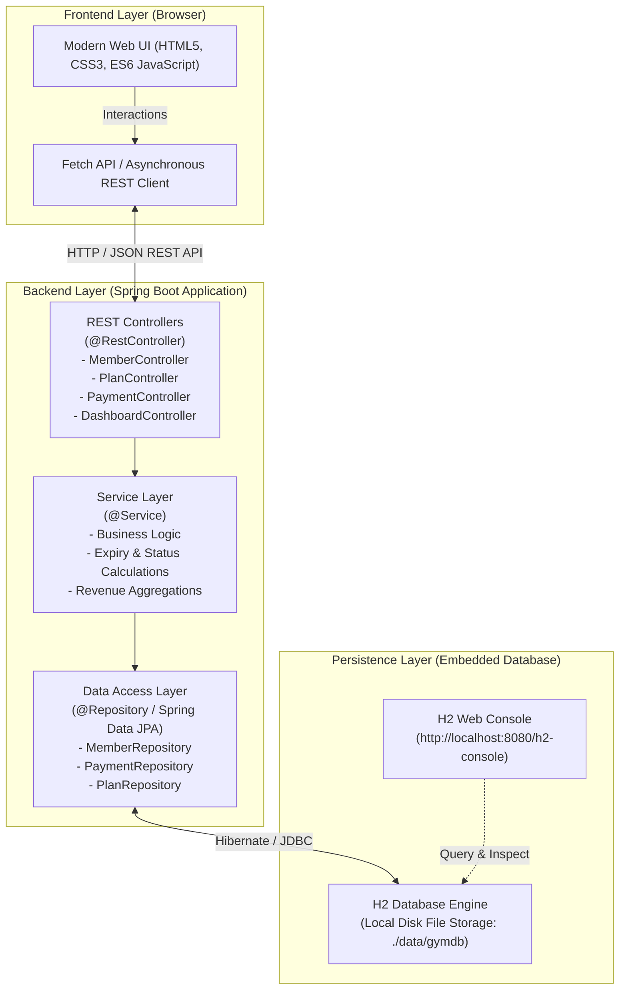

🏋️ Gym Membership Management System
A full-stack web application for managing gym members, membership plans, payment records, and membership renewals.
📌 Project Overview
The Gym Membership Management System helps gym administrators organize member details, assign membership plans, record payments, and track memberships approaching expiry or already expired.
✨ Features
- Dashboard — View member statistics, active memberships, expired memberships, and recorded revenue.
- Member Management — Register and manage member details.
- Membership Plans — View available plans, durations, and prices.
- Payment Records — Record and review membership payments.
- Renewal Tracking — Identify memberships expiring soon or already expired.
- Database Integration — Store and retrieve application data through the backend.
Note: Payment records are recorded in the system; they do not process real transactions through a payment gateway. Only describe features as complete if they are implemented and tested in your current version.

🧰 Technologies Used
Layer	Technology
Frontend	React, Vite, JavaScript, HTML, CSS
Backend	Java, Spring Boot
Database	MySQL
Build tools	Maven, npm


📁 Project Structure
gym/
├── backend/       # Java Spring Boot backend and API
├── frontend/      # React + Vite user interface
├── database/      # SQL scripts and database setup files
└── README.md      # 🏋️‍♂️ MemberFlow — Gym & Membership Management System

Key Features:
### 1. 📊 Executive Dashboard
* Real-time KPI statistics:
  * **Total Registered Members**
  * **Active Memberships Count**
  * **Total Recorded Revenue** (aggregated across all payment methods)
  * **Renewals Due within 7 Days** (proactive retention alerts)
* Quick-action shortcuts for new member registrations and payment entry.

### 2. 👤 Member Registration & Management
* Register members with comprehensive profiles: Full Name, Email, Phone Number, Selected Plan, Start Date, and End Date.
* Instant client-side & server-side search by name, phone, or email.
* Safe deletion of member records with cascade handling for associated payment records.

### 3. 📅 Membership Plans & Renewal Tracking
* Multiple billing durations:
  * 🟢 **Active**: Valid membership.
  * 🟡 **Renew Soon**: Expiring within the next 7 days.
  * 🔴 **Expired**: Past expiry date.
* Seamless renewal workflow with automated expiry date extension.

### 4. 💳 Payment Records & Invoicing
* Multi-mode payment recording:
  * **Cash**
  * **UPI** (Google Pay, PhonePe, Paytm, etc.)
  * **Credit / Debit Card**
  * **Bank Transfer (NEFT/IMPS)**
* Chronological payment transaction history linked to individual member profiles.
* Generates receipt timestamps and transaction references.

---

## 🏗️ System Architecture



### Data Flow Overview
1. **User Action**: The client triggers actions via modern, responsive web components.
2. **REST Call**: JavaScript dispatches JSON payloads to Spring Boot REST endpoints.
3. **Business Validation**: Spring Boot service layer validates dates, calculates membership status (Active / Renew Soon / Expired), and computes financial metrics.
4. **Data Persistence**: Spring Data JPA maps entities seamlessly to embedded H2 tables on local disk, ensuring zero data loss across application restarts.

---

## 📂 Project Directory Structure

```plaintext
gym-management-system/
├── pom.xml                               # Maven project dependencies & build configuration
├── README.md                             # Comprehensive project documentation
├── mvnw                                  # Maven Wrapper script (Linux/macOS)
├── mvnw.cmd                              # Maven Wrapper script (Windows)
├── src/
│   ├── main/
│   │   ├── java/
│   │   │   └── com/
│   │   │       └── gym/
│   │   │           └── management/
│   │   │               ├── GymManagementApplication.java      # Application entrypoint
│   │   │               ├── controller/                       # REST API controllers
│   │   │               │   ├── DashboardController.java
│   │   │               │   ├── MemberController.java
│   │   │               │   ├── MembershipPlanController.java
│   │   │               │   └── PaymentController.java
│   │   │               ├── dto/                              # Data Transfer Objects
│   │   │               │   ├── DashboardStatsDTO.java
│   │   │               │   ├── MemberRequestDTO.java
│   │   │               │   └── PaymentRequestDTO.java
│   │   │               ├── entity/                           # JPA Entities
│   │   │               │   ├── Member.java
│   │   │               │   ├── MembershipPlan.java
│   │   │               │   └── Payment.java
│   │   │               ├── repository/                       # Spring Data JPA Repositories
│   │   │               │   ├── MemberRepository.java
│   │   │               │   ├── MembershipPlanRepository.java
│   │   │               │   └── PaymentRepository.java
│   │   │               └── service/                          # Business logic interfaces & impls
│   │   │                   ├── DashboardService.java
│   │   │                   ├── MemberService.java
│   │   │                   ├── MembershipPlanService.java
│   │   │                   └── PaymentService.java
│   │   └── resources/
│   │       ├── application.properties                        # Spring Boot & H2 DB configuration
│   │       └── static/                                       # Frontend web assets (served directly)
│   │           ├── index.html                                # Single Page App / Dashboard layout
│   │           ├── css/
│   │           │   └── styles.css                            # Custom modern responsive styling
│   │           └── js/
│   │               ├── app.js                                # Core SPA navigation & router
│   │               ├── dashboard.js                          # Dashboard stats & metrics loader
│   │               ├── members.js                            # Member CRUD & search operations
│   │               ├── plans.js                              # Plan selection & renewal triggers
│   │               └── payments.js                           # Payment records & transaction logs
│   └── test/
│       └── java/
│           └── com/
│               └── gym/
│                   └── management/
│                       └── GymManagementApplicationTests.java
└── data/                                                     # Local H2 persistent storage folder
    └── gymdb.mv.db                                           # Auto-generated database file
```

---

## 💻 Technology Stack

| Layer | Component | Version / Specification | Role |
| :--- | :--- | :--- | :--- |
| **Frontend** | HTML5 | Living Standard | Semantic page layout and forms |
| **Frontend** | CSS3 | Modern CSS | Dark/Light themes, flexbox/grid layout, responsive design |
| **Frontend** | JavaScript | ES6+ | Fetch API calls, dynamic DOM updates, reactive stats |
| **Backend** | Java | 17 LTS | Core object-oriented server programming |
| **Backend** | Spring Boot | 3.2.x+ | Application framework, embedded Tomcat container |
| **Data Access**| Spring Data JPA | 3.2.x+ (Hibernate) | ORM entity mapping and repository abstraction |
| **Database** | H2 Database | Embedded (v2.x) | Lightweight, file-based embedded SQL database |
| **Protocol** | REST API | JSON over HTTP | Asynchronous client-server communication |

---

## 🗄️ Database Configuration (H2)

The application uses an embedded H2 database configured in persistent file mode (`./data/gymdb`). This eliminates the need to run MySQL, PostgreSQL, or Docker while preserving records permanently.

### `src/main/resources/application.properties`
```properties
# Server Port
server.port=8080

# H2 File-Based Storage Configuration
spring.datasource.url=jdbc:h2:file:./data/gymdb;DB_CLOSE_DELAY=-1;DB_CLOSE_ON_EXIT=FALSE
spring.datasource.driverClassName=org.h2.Driver
spring.datasource.username=sa
spring.datasource.password=password

# JPA / Hibernate Properties
spring.jpa.database-platform=org.hibernate.dialect.H2Dialect
spring.jpa.hibernate.ddl-auto=update
spring.jpa.show-sql=false
spring.jpa.properties.hibernate.format_sql=true

# Enable H2 Web Console for development inspection
spring.h2.console.enabled=true
spring.h2.console.path=/h2-console
spring.h2.console.settings.web-allow-others=false
```

---

## 🚀 API Endpoints Reference

### 📊 1. Dashboard (`/api/dashboard`)
| Method | Endpoint | Description |
| :--- | :--- | :--- |
| `GET` | `/api/dashboard/stats` | Returns total members, active count, revenue, and renewals due in 7 days |

### 👤 2. Members (`/api/members`)
| Method | Endpoint | Description |
| :--- | :--- | :--- |
| `GET` | `/api/members` | Retrieve all registered members |
| `GET` | `/api/members/{id}` | Retrieve single member details |
| `POST` | `/api/members` | Register a new member |
| `PUT` | `/api/members/{id}` | Update member profile |
| `DELETE`| `/api/members/{id}` | Delete member record |
| `GET` | `/api/members/search?q={query}` | Search members by name, email, or phone |

### 📅 3. Plans & Renewals (`/api/plans`)
| Method | Endpoint | Description |
| :--- | :--- | :--- |
| `GET` | `/api/plans` | Fetch available plans (Monthly, Quarterly, Half-Yearly, Yearly) |
| `POST` | `/api/members/{id}/renew` | Renew membership with selected plan duration |

### 💳 4. Payments (`/api/payments`)
| Method | Endpoint | Description |
| :--- | :--- | :--- |
| `POST` | `/api/payments` | Record payment (`CASH`, `UPI`, `CARD`, `BANK_TRANSFER`) |
| `GET` | `/api/payments` | Retrieve full payment history |
| `GET` | `/api/payments/member/{memberId}`| Get payment transaction history for a specific member |

---

## 🛠️ Getting Started

### Prerequisites
* **Java Development Kit (JDK) 17** or later ([Download JDK 17](https://adoptium.net/))
* **Maven 3.8+** (Optional: the included `./mvnw` wrapper can be used directly)
* Any modern web browser (Chrome, Edge, Firefox, Safari)
* Git installed on your system

---

### Step 1: Clone the Repository
```bash
git clone https://github.com/your-username/gym-management-system.git
cd gym-management-system
```

---

### Step 2: Build and Run the Backend
Using Maven Wrapper:

**On Windows (PowerShell / Command Prompt):**
```powershell
.\mvnw.cmd clean spring-boot:run
```

**On macOS / Linux:**
```bash
chmod +x ./mvnw
./mvnw clean spring-boot:run
```

Once started, the backend server will launch on port `8080`.

---

### Step 3: Access the Application
Open your web browser and navigate to:
```text
http://localhost:8080
```
The static frontend files (`index.html`, `styles.css`, `app.js`) are served directly by Spring Boot.

---

### Step 4: Access H2 Database Console
You can view and query raw database tables directly through the embedded H2 Web Console:
1. Navigate to: `http://localhost:8080/h2-console`
2. Enter the following connection parameters:
   * **JDBC URL**: `jdbc:h2:file:./data/gymdb`
   * **User Name**: `sa`
   * **Password**: `password`
3. Click **Connect**.

---

## 🔮 Future Roadmap
- [ ] Automated SMS/WhatsApp notifications for memberships expiring in 7 days.
- [ ] Export member and payment reports to PDF / Excel (CSV).
- [ ] Role-Based Access Control (Admin vs. Front-Desk Staff).
- [ ] QR-code-based check-in attendance tracking.

---

## 📄 License
This project is licensed under the **MIT License** — feel free to use and adapt it for personal, academic, or commercial projects.
